<p align="center">
  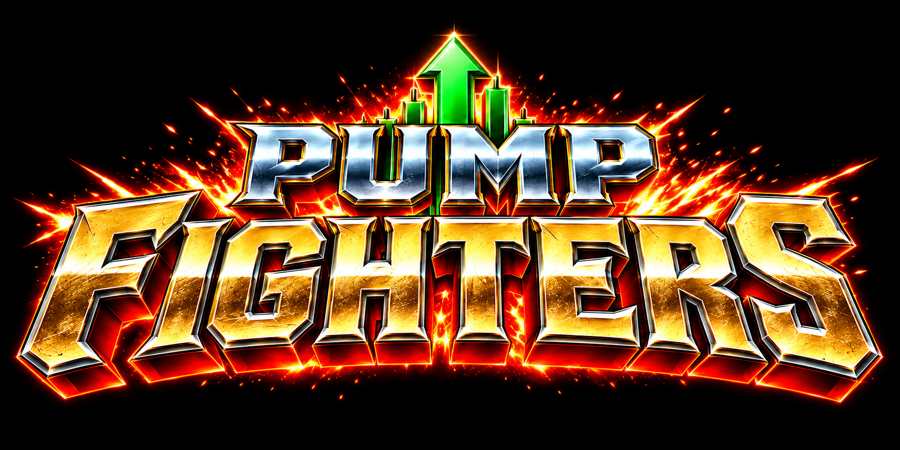
</p>

<p align="center"><b>Street Fighter III: 3rd Strike, but the whole cast is pump.fun mascots.</b><br>
A fan mod. You bring your own game file, we bring the cats, frogs and dogs.</p>

<p align="center"><b><a href="https://pumpfighters.fun">pumpfighters.fun</a></b> · trailer, roster, play in the browser</p>

---

## What it is

PUMP FIGHTERS is a fan-made, non-commercial mod of **Street Fighter III: 3rd Strike**. All 20 fighters are
redrawn as pump.fun mascots. Each mascot keeps the moves, frame data and AI of the SF3 fighter it replaces,
so the game plays like 3rd Strike underneath.

What changes:

- new logo and title screen
- new character-select, VS and win portraits
- new fighter sprites: every animation frame of every fighter redrawn as the mascot (about 20,000 frames)
- new names, HUD name plates and face icons
- a redrawn opening

What stays: moves, hitboxes, sound, music, stages and AI.

**This repo ships a patch, not a game.** You need your own copy of the game: the `SF33RD.AFS` file from the
PS2 disc (US, v1.0). The patcher checks that exact file and builds PUMP FIGHTERS from it on your device.
No Capcom files are in this repo or in the release.

<p align="center">
  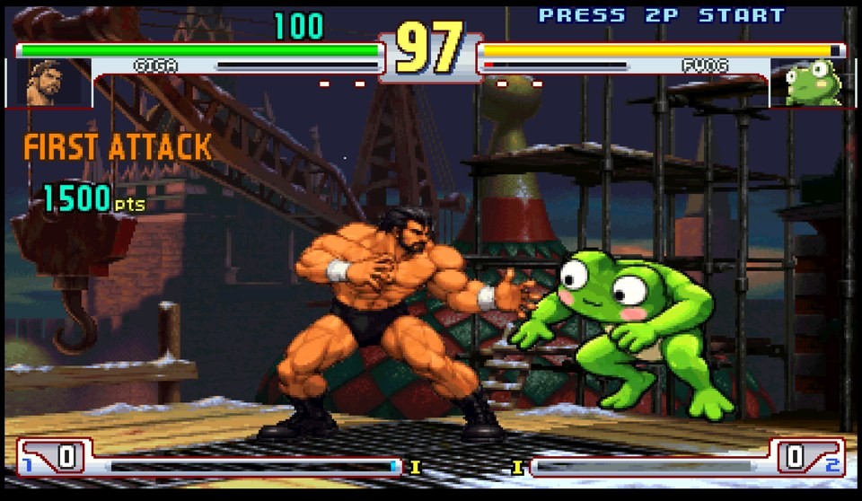
  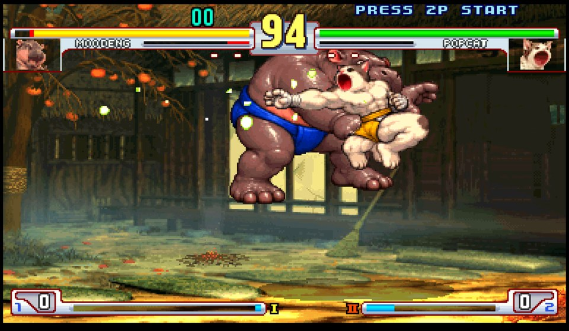<br>
  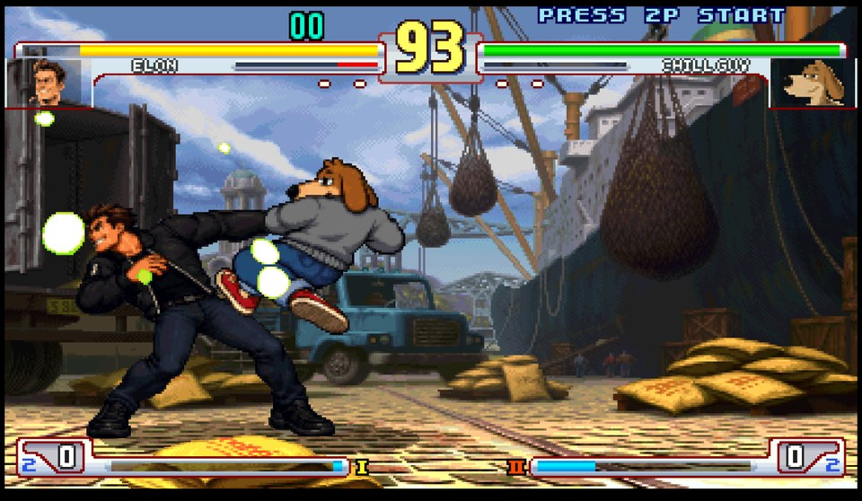
  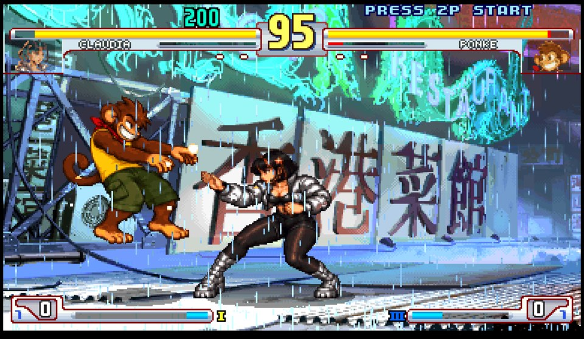<br>
  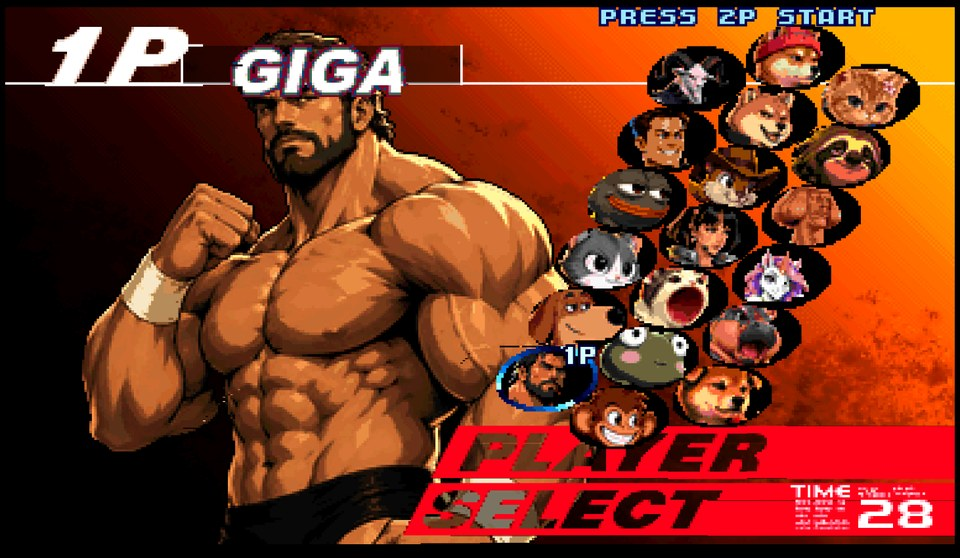
  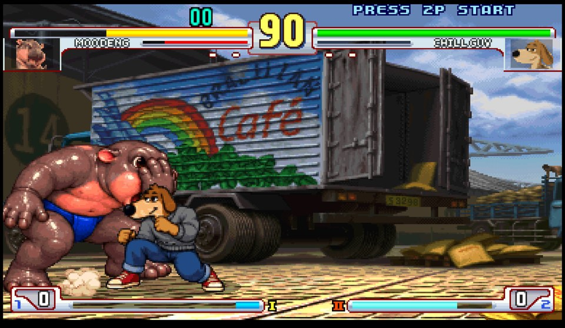
</p>

## The roster

| | Mascot | Moves of |
|---|---|---|
| 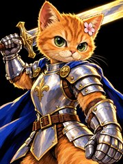 | **SWORDCAT** | Ryu |
| 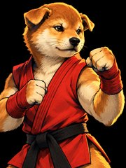 | **INU** | Ken |
| 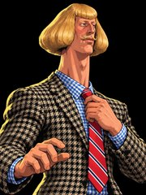 | **JEAN PHIL** | Dudley |
| 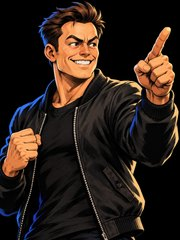 | **ELON** (parody) | Urien |
| 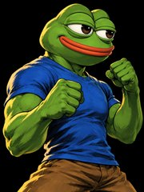 | **PEPE** | Necro |
| 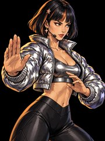 | **CLAUDIA** | Chun-Li |
| 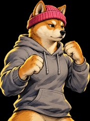 | **WIF** | Yun |
| 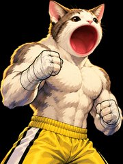 | **POPCAT** | Makoto |
|  | **PNUT** | Q |
| 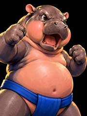 | **MOO DENG** | Hugo |
| 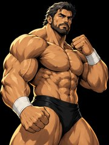 | **GIGA** | Alex |
| 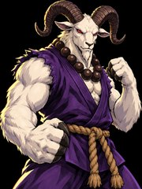 | **GOAT** | Akuma |
| 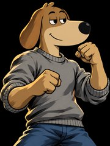 | **CHILL GUY** | Sean |
| 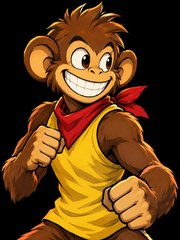 | **PONKE** | Yang |
| 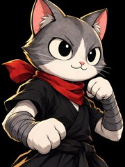 | **MEW** | Ibuki |
| 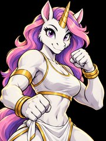 | **PIPPIN** | Elena |
|  | **SLERF** | Oro |
| 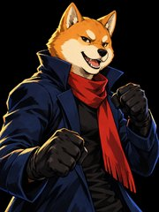 | **BONK** | Remy |
| 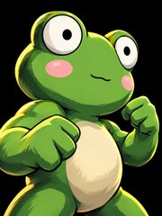 | **FWOG** | Twelve |
| 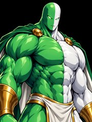 | **PILL** (final boss) | Gill |

## How to play

### 1. In the browser (phone or PC)

1. Open **https://pumpfighters.fun/play/**.
2. Tap **PICK SF33RD.AFS** and choose the file from your own disc.
3. The page checks the file and patches it inside your browser. Nothing is uploaded.
4. Tap to fight. The patched copy stays in this browser's own storage, so next time it starts right away.

Touch controls are on screen. On a PC, a keyboard or a gamepad works.

### 2. PSP or PPSSPP (Android, iPhone, PC)

PUMP FIGHTERS also runs on **3s-psp**, the PSP port of 3rd Strike, on a real PSP or in the PPSSPP emulator.

1. Get the `EBOOT.PBP` from the 3s-psp project's own release:
   **https://github.com/demmis98/3s-psp**. We only link to it. 3s-psp has no license, so we don't re-upload it.
2. Make the modded `SF33RD.AFS`, either way:
   - **Web:** open the patch page (**https://pumpfighters.fun/play/patch.html**), pick your file, save the modded one.
   - **Command line** (Node 18+), using the patch files from this repo's
     [Releases](https://github.com/MTG9T4/pump-fighters/releases) put in `patch/`:
     ```
     node patcher/patch.mjs <your SF33RD.AFS> <out SF33RD.AFS>
     ```
     Your original is only read, never overwritten.
3. Lay the files out like this (the folder name is up to you, e.g. `3rd-strike`):
   ```
   PSP/GAME/<folder>/
     EBOOT.PBP
     resources/
       SF33RD.AFS      <- the modded file
   ```
   - Android: PPSSPP shows its memory stick folder under Settings > System.
   - iPhone: Files > On My iPhone > PPSSPP > PSP > GAME.
   - Windows: usually `Documents/PPSSPP/PSP/GAME/`.
4. Start PPSSPP and open the game. Landscape works best on a phone.

### 3. Finding SF33RD.AFS on your disc

- Make a disc image (ISO) of **your own** PS2 copy of *Street Fighter III: 3rd Strike* (US release, v1.0).
- Open the image (7-Zip, or mount it) and copy `THIRD/SF33RD.AFS` out of it.
- The right file is **642,492,416 bytes** with SHA-256
  `f9fa50f3a124ec9fa9465aa9c8546c2d867887eb39f711a070762a0324ba5604`.

**How the check works.** Before writing anything, the patcher compares your file's size and its table of
contents with the patch manifest. That catches a wrong file or another version straight away. While it
patches, it hashes your whole file in 8 MiB chunks and compares every chunk, plus the full SHA-256 above, so
a damaged or already-modded copy is refused. Then it checks the SHA-256 of the result. If any check fails
you get a plain message and your original file is left as it was.

We can't help you get the game. Please don't open issues asking for game files or links to them.

## What's in this repo

| Folder | What |
|---|---|
| `patcher/` | The patcher: one library for the browser and Node, the CLI, the patch generator and unit tests |
| `patch/` | Empty here. The patch files (~54 MB) are attached to each GitHub Release |
| `web/` | The browser app, its Cloudflare Worker, and our patch to 3SX. See [web/BUILDING.md](web/BUILDING.md) |
| `tools/` | The art and modding pipeline that made the patch. See [tools/MODDING.md](tools/MODDING.md) |
| `docs/img/` | Images for this page |

Run the patcher tests:

```
cd patcher && npm install && npm test
```

The tests build small fake AFS archives, so they need no game data. Some tests also need Python 3.

## Credits

- The **3rd Strike decompilation** community and **[crowded-street](https://github.com/crowded-street)**, who made
  the game's code readable and portable.
- **[3SX](https://github.com/crowded-street/3sx)** (AGPL-3.0): the native port. Our browser build is 3SX
  compiled with Emscripten plus a small patch (`web/3sx-web.patch`).
- **[3s-psp](https://github.com/demmis98/3s-psp)**: the PSP port.
- **[PPSSPP](https://www.ppsspp.org/)**: the PSP emulator.
- Mascot art, logo, portraits and the redrawn opening were made for this mod with AI image tools, then
  rigged and posed by the scripts in `tools/`.

## Disclaimer

PUMP FIGHTERS is a **fan-made, non-commercial mod**. It is **not affiliated with, endorsed by or sponsored by
Capcom**. Street Fighter and Street Fighter III: 3rd Strike are trademarks of Capcom Co., Ltd.

You must own a legal copy of the game to use this mod. No Capcom assets are distributed here: the patch holds
only the changes (our art, packed as deltas against the original file), and it only works on your own copy.

The mascots are characters and memes from the pump.fun / crypto community. They belong to their respective
creators and communities and appear here as fan art and parody. ELON is a parody of a public figure and is
not endorsed by him. See [NOTICE](NOTICE).

## License

- Code: **AGPL-3.0** ([LICENSE](LICENSE)), the same as 3SX.
- Our original artwork: **CC BY-NC-SA 4.0** ([ART-LICENSE.md](ART-LICENSE.md)).
- Third-party characters and trademarks: see [NOTICE](NOTICE).
